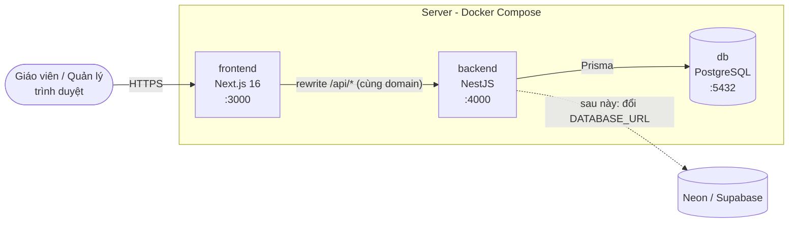
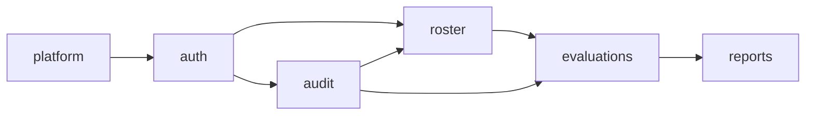
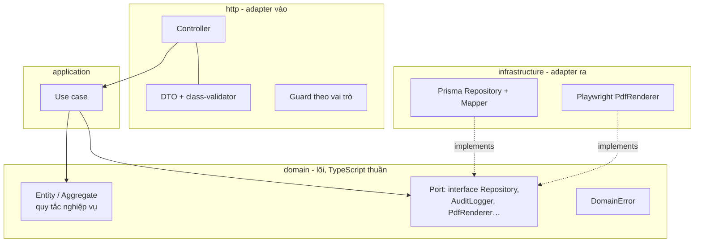
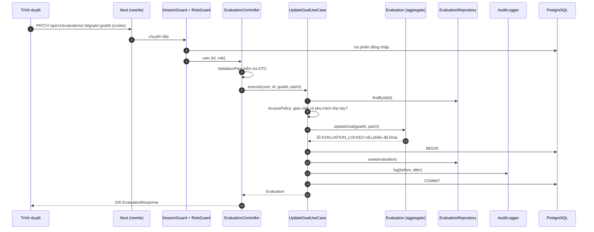
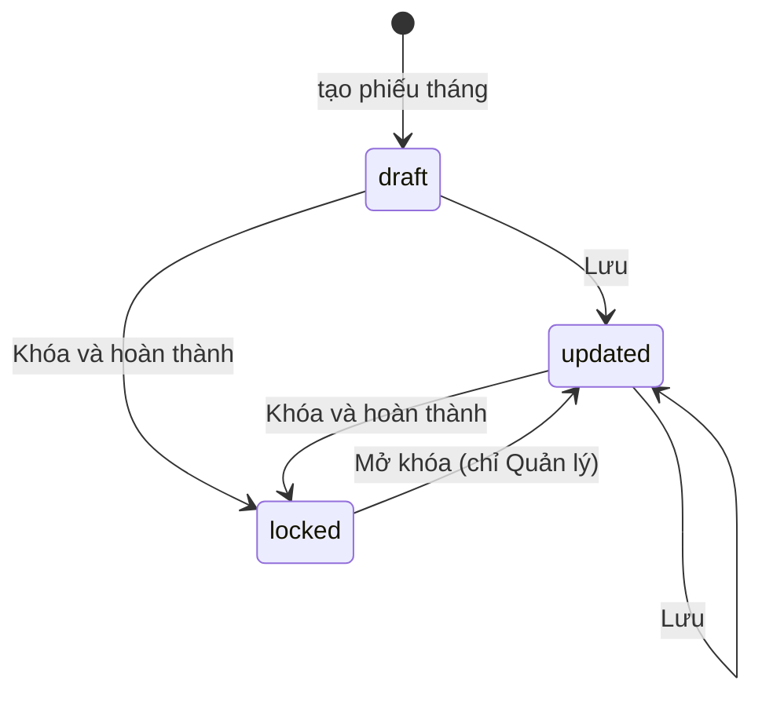
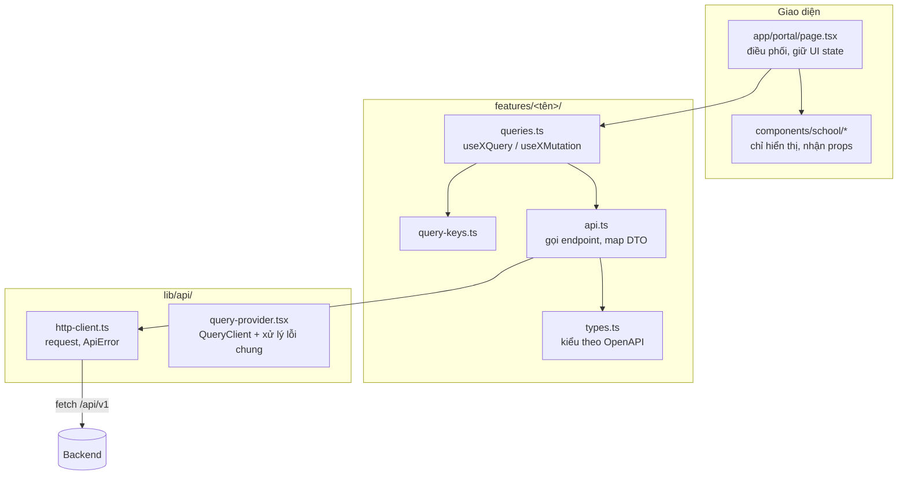

# Kiến trúc tổng quan

Tài liệu này mô tả kiến trúc và các design pattern của toàn bộ hệ thống (FE + BE). Đây là "bản đồ" để mọi module tuân theo. Chi tiết từng phần nằm ở [SPEC-backend.md](../SPEC-backend.md), các `SPEC-<module>.md` và [frontend/docs/architecture.md](../frontend/docs/architecture.md).

## 1. Bức tranh lớn



| Quyết định | Lý do |
|---|---|
| **2 project độc lập** `frontend/` và `backend/`, không dùng chung kiểu dữ liệu | Mỗi bên build, test, deploy riêng. Hợp đồng giữa hai bên là **HTTP API**, có OpenAPI làm tài liệu |
| **FE gọi BE qua rewrite cùng domain** (`/api/*`) | Cookie phiên đăng nhập là first-party; không cần CORS; không nhúng URL API vào bundle lúc build |
| **Mỗi service một container**, cổng 3000 / 4000 / 5432 | Không cài gì lên máy hay server ngoài Docker. Chỉ cổng 3000 mở ra ngoài |
| **Modular monolith** cho backend | Một trung tâm, quy mô nhỏ: một service là đủ. Ranh giới module rõ ràng, nên khi cần vẫn tách được thành service riêng |

## 2. Backend: Modular Monolith + Clean Architecture

### 2.1 Module và hướng phụ thuộc



Mũi tên nghĩa là "được dùng bởi". Phụ thuộc giữa các module **không có vòng**. Một module chỉ dùng module khác qua những gì module đó `export` (use case hoặc service công khai), không import file nội bộ của nhau.

### 2.2 Bốn lớp trong một module (Ports & Adapters)



| Lớp | Được phép biết | Không được biết |
|---|---|---|
| `domain` | Chỉ TypeScript | Nest, Prisma, HTTP |
| `application` | `domain` | Prisma, HTTP |
| `infrastructure` | `domain`, Prisma, thư viện ngoài | `http` |
| `http` | `application`, DTO | Prisma |

Nhờ vậy:

- logic nghiệp vụ được unit test mà không cần DB;
- đổi DB (Postgres local sang Neon hoặc Supabase) chỉ chạm tới config;
- đổi cách tạo PDF chỉ chạm tới một adapter.

### 2.3 Các design pattern dùng trong backend

| Pattern | Dùng ở đâu | Cách áp dụng |
|---|---|---|
| **Dependency Injection** | Toàn bộ | Container DI của Nest. Port được inject qua token `Symbol` |
| **Repository** | `domain/*.repository.ts` + `infrastructure/prisma-*.repository.ts` | Use case chỉ thấy interface. Prisma bị giới hạn trong infrastructure |
| **Use Case / Command** | `application/*.use-case.ts` | Một class cho mỗi thao tác, có một method `execute()`. Thêm tính năng là thêm use case, không phình class cũ |
| **Aggregate** | `Evaluation` (gồm các tiêu chí và mục tiêu của phiếu) | Mọi thay đổi trên phiếu đi qua aggregate root, nên quy tắc "đã khóa thì không sửa" chỉ kiểm tra ở một chỗ |
| **State Machine** | Trạng thái phiếu | Các chuyển trạng thái hợp lệ được khai báo trong domain; chuyển sai thì ném `DomainError` (xem 2.5) |
| **Snapshot** | Tiêu chí của phiếu | Phiếu chép lại danh mục tiêu chí tại thời điểm tạo phiếu (xem 2.6) |
| **Unit of Work** | Use case ghi dữ liệu | `prisma.$transaction`: dữ liệu nghiệp vụ và bản ghi audit được ghi cùng một transaction, hoặc cả hai, hoặc không gì cả |
| **DTO + Mapper** | `http/` và `infrastructure/` | Response API không bao giờ là bản ghi Prisma. Có mapper riêng `Prisma ↔ Entity` và `Entity → Response` |
| **Adapter** | `PdfRenderer`, `PasswordHasher`, `Clock` | Mọi thứ phụ thuộc bên ngoài đều đứng sau một port, test thì thay bằng bản giả |
| **Policy / Guard (RBAC)** | `auth` + từng module | Guard kiểm tra vai trò ở route. Phạm vi dữ liệu ("giáo viên chỉ thấy lớp mình") kiểm tra trong use case, qua `AccessPolicy` |
| **Centralized error translation** | `common/errors` | Domain ném `DomainError(code, message)`. Exception filter duy nhất map sang HTTP theo định dạng `{ error: { code, message, details } }` |
| **Fail-fast configuration** | `config/` | Kiểm tra biến môi trường lúc khởi động; sai thì dừng app ngay |
| **Soft delete** | Học sinh, lớp | Đánh dấu `deletedAt` thay vì xóa. Repository mặc định lọc bỏ bản ghi đã xóa |

### 2.4 Một request đi qua hệ thống

Ví dụ: giáo viên sửa đánh giá một mục tiêu.



### 2.5 Vòng đời phiếu đánh giá



- Khi phiếu ở `locked`: không thêm, sửa hay xóa mục tiêu.
- Mở khóa phải có lý do, và được ghi vào audit.

### 2.6 Tiêu chí linh động: Catalog + Snapshot

Quản lý được thêm, sửa, sắp xếp và ẩn tiêu chí. Nếu phiếu chỉ tham chiếu thẳng tới danh mục, thì sửa tên một tiêu chí sẽ làm **thay đổi cả các phiếu và PDF đã khóa từ những tháng trước**. Với hồ sơ của trẻ, điều đó không chấp nhận được.

Giải pháp:

- **Danh mục (`Criterion`):** dùng cho phiếu mới. Không xóa tiêu chí, chỉ ẩn (`isActive = false`).
- **Snapshot (`EvaluationCriterion`):** khi tạo phiếu tháng, hệ thống chép các tiêu chí đang hoạt động (tên, nhóm, thứ tự) vào phiếu. Mục tiêu can thiệp gắn với snapshot này. Sửa danh mục **chỉ ảnh hưởng tới phiếu tạo sau đó**.
- **PDF dựng từ snapshot:** gộp ô theo `groupName`. Tiêu chí không có nhóm chiếm trọn hai cột, giống mẫu GDCN.

### 2.7 Mô hình dữ liệu

```mermaid
erDiagram
  User ||--o{ Session : has
  User ||--o{ Class : "phụ trách"
  Class ||--o{ Student : has
  Student ||--o{ Evaluation : "1 phiếu / tháng"
  Evaluation ||--|{ EvaluationCriterion : "snapshot"
  Criterion ||--o{ EvaluationCriterion : "nguồn"
  EvaluationCriterion ||--o{ EvaluationGoal : has
  User ||--o{ AuditLog : "thực hiện"

  User { uuid id string email string fullName enum role bool isActive }
  Class { uuid id string name uuid teacherId datetime deletedAt }
  Student { uuid id uuid classId string name date birthDate datetime deletedAt }
  Criterion { uuid id string name string groupName int position bool isActive }
  Evaluation { uuid id uuid studentId string month enum status datetime lockedAt }
  EvaluationCriterion { uuid id uuid criterionId string name string groupName int position }
  EvaluationGoal { uuid id string content enum result int position }
  AuditLog { uuid id uuid actorId string entityType uuid entityId string action json before json after }
```

Trên PDF:

- **Tuổi** tính từ `birthDate` tại tháng của phiếu.
- **Trị liệu viên** là giáo viên phụ trách lớp. Khi khóa phiếu, tên trị liệu viên được chép vào phiếu để PDF cũ không đổi nếu lớp đổi giáo viên.

## 3. Frontend: TanStack Query + SOLID

Giao diện và quy ước UI giữ nguyên ([frontend/docs/architecture.md](../frontend/docs/architecture.md)). Thay đổi lớn là **tách state của server khỏi state của giao diện**, và bỏ hook "ôm mọi thứ" `useSchoolManagement`.

| Loại state | Ví dụ | Quản lý bằng |
|---|---|---|
| **Server state** | lớp, học sinh, phiếu, tiêu chí, user đang đăng nhập | **TanStack Query** (cache, refetch, invalidate). Không copy sang `useState` |
| **UI state** | tab, bộ lọc lớp, tháng, modal đang mở, ô tìm kiếm | `useState` trong component điều phối, hoặc query string trên URL |

### 3.1 Các lớp



```
frontend/src/
├── lib/api/
│   ├── http-client.ts       # request<T>(): credentials, JSON, parse { error } → ApiError, 401 → onUnauthorized
│   ├── api-error.ts         # class ApiError(status, code, message tiếng Việt, details)
│   └── query-provider.tsx   # QueryClientProvider, mặc định retry/staleTime, xử lý 401 toàn cục
└── features/
    ├── auth/        api.ts · queries.ts · query-keys.ts · types.ts
    ├── classes/     …
    ├── students/    …
    ├── evaluations/ …        # + logic thuần (tính tiến độ) có unit test
    ├── criteria/    …
    └── reports/     …
```

### 3.2 SOLID trong frontend

| Nguyên tắc | Áp dụng cụ thể |
|---|---|
| **S** (một trách nhiệm) | `http-client` chỉ lo truyền tải. `api.ts` chỉ biết endpoint. `queries.ts` chỉ lo cache. Component chỉ hiển thị. Logic tính toán (tiến độ, tuổi, nhóm tiêu chí) là hàm thuần trong `features/`, có test |
| **O** (mở để mở rộng) | Thêm nghiệp vụ là thêm một thư mục `features/<tên>/`, không sửa `http-client` hay `query-provider`. Hành vi chung (401, toast lỗi) cấu hình một lần ở `QueryClient` |
| **L** (thay thế được) | Mọi hàm trong `api.ts` có cùng hợp đồng: trả về dữ liệu đúng kiểu, hoặc ném `ApiError`. Hook và component không phân biệt lỗi mạng hay lỗi nghiệp vụ, chỉ đọc `error.message` |
| **I** (interface nhỏ) | Thay `useSchoolManagement` (17 giá trị trả về) bằng các hook nhỏ: `useClasses()`, `useStudents(filter)`, `useEvaluation(studentId, month)`, `useUpdateGoal()`… Component chỉ nhận đúng props mình dùng |
| **D** (phụ thuộc abstraction) | Component phụ thuộc hook, không gọi `fetch`. Hook phụ thuộc hàm trong `api.ts`. `api.ts` phụ thuộc `request()`. Test thay được từng tầng |

### 3.3 Quy ước TanStack Query

- **Query key factory** cho mỗi feature, ví dụ `studentKeys.list({ classId })` và `studentKeys.detail(id)`. Không viết key bằng chuỗi rời rạc.
- **Mutation xong thì invalidate đúng key liên quan.** Ví dụ thêm học sinh thì invalidate `studentKeys.lists()` và `classKeys.lists()` (vì số học sinh của lớp thay đổi).
- **Optimistic update chỉ dùng cho thao tác nhỏ và thường xuyên** (chọn đánh giá `+`, `+/-`, `-`). Lỗi thì rollback và hiện thông báo. Ô nhập nội dung can thiệp gửi lên sau khi ngừng gõ (debounce), không gửi theo từng phím.
- **Lỗi:** `ApiError.message` hiện thẳng cho người dùng (BE đã trả về tiếng Việt). Gặp 401 thì `query-provider` xóa cache và chuyển về `/login`.
- **Trạng thái tải:** component dùng `isPending` / `isError` của query. Không tự tạo cờ `loading` riêng.
- **Chuyển đổi từng bước:** mỗi module BE xong thì thay phần mock tương ứng. `useSchoolManagement` co dần và bị xóa sau module `evaluations`.

## 4. Các nguyên tắc xuyên suốt

| Chủ đề | Nguyên tắc |
|---|---|
| Bảo mật | Mật khẩu hash bằng `crypto.scrypt` có sẵn của Node (N=2^17, r=8, p=1; tham số lưu trong chuỗi hash). DB chỉ lưu SHA-256 của token phiên. Cookie phiên đặt `httpOnly`, `secure`, `sameSite=lax`. Phân quyền kiểm tra ở server, không tin FE |
| Dữ liệu trẻ em | Giáo viên chỉ thấy lớp mình phụ trách. Mọi thay đổi đều có audit. Không ghi dữ liệu cá nhân của trẻ vào log |
| Ngôn ngữ | Code, `code` lỗi, tên cột viết bằng tiếng Anh. Mọi thông báo cho người dùng viết bằng tiếng Việt |
| Thời gian | Lưu thời điểm theo UTC. "Tháng hiện tại" tính theo múi giờ `Asia/Ho_Chi_Minh` |
| Cấu hình | Tên trung tâm, địa chỉ, secret đọc từ biến môi trường. Không viết cứng |
| Tính di động của DB | Chỉ dùng PostgreSQL chuẩn qua Prisma. Không dùng tính năng riêng của nhà cung cấp |
| Dữ liệu thử | `pnpm db:seed` (= `dist/cli/create-manager.js`) tạo tài khoản Quản lý đầu tiên. `pnpm db:seed:demo` tạo dữ liệu mẫu (`@demo.local`), `node dist/cli/seed-demo.js --clean` xóa sạch; bị chặn khi `NODE_ENV=production` |
| Kiểm thử | Domain và use case dùng unit test (không DB). Endpoint dùng e2e với Postgres thật. FE dùng `pnpm build`, `a11y-check`, `screenshot` |
